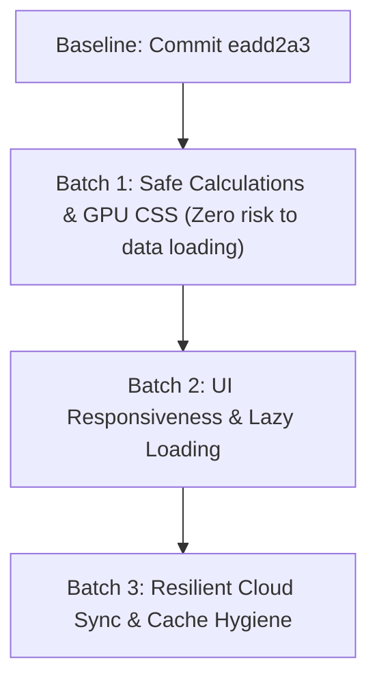

# Awrady Performance Optimization Plan (Batch-by-Batch Roadmap)

## Context & Objectives
This document preserves the step-by-step performance optimization roadmap for **Awrady (Enjaz)**, starting from the known-good, stable baseline commit `eadd2a3` ("Chart: remove custom-range, add LTTB downsampling & tooltip").

### Execution Principles
1. **Incremental Batch Delivery:** Execute changes strictly batch by batch.
2. **Safe Order of Execution:** Start with changes that cannot affect or disrupt data loading (calculations & CSS/GPU rendering first).
3. **Thorough Verification:** After each batch, run automated and manual tests to ensure zero regressions in UI or data loading.
4. **Commit & Push After Verification:** Once a batch is verified, commit and push to remote.
   - **Commit Convention:** Every commit must have a **brief title** on the first line and **brief bulleted points** in the description body (no long text, e.g., `git commit -m "Brief title" -m "- Brief point 1\n- Brief point 2"`).
5. **Simplicity Over Complexity (KISS):** If an optimization is unnecessary or overly complex, skip it.

---

## Batch Roadmap



---

## Batch 1: Calculations Memoization & GPU / CSS Optimization
> **Risk Level:** Zero risk to data loading or database synchronization.

### 1.1 GPU & Compositing Optimization (`awrad-ui/style.css`)
- **Background Orbs:** Replace expensive live `filter: blur(130px)` on `.glow-orb` with hardware-accelerated radial gradients (`radial-gradient(...)`) and `transform: translateZ(0)` / `will-change: transform`.
- **Remove Nested Backdrops:** Strip `backdrop-filter: blur(16px)` from repeated child cards (70+ task items: `.task-card`, `.task-item-minimal`, `.breakdown-card`, `.stat-pill`) to eliminate frame drops and provide 60/120 FPS scrolling.

### 1.2 High-Speed Date & Hijri Memoization (`awrad-ui/js/utils/date-utils.js`)
- **Hijri Date Cache:** Memoize `getHijriDateDetails(dateStr)` using a `Map`. Avoid creating thousands of expensive `Intl.DateTimeFormat` instances on every score calculation loop.
- **Fast Weekday Lookup:** Replace `toLocaleDateString` in `getDayOfWeekAbbrev(dateStr)` with static array indexing `["Sun", "Mon", "Tue", "Wed", "Thu", "Fri", "Sat"]`.
- **Reusable Intl Formatters:** Re-use persistent `Intl` formatter instances instead of creating new instances per call.

### 1.3 Schedule Engine Property Caching (`awrad-ui/js/core/schedule-engine.js`)
- **Effective Properties Cache:** Cache `getTaskEffectiveProps` per task instance and date in `task._effPropsCache`.
- **History Pre-Sorting:** Cache sorted history `task._sortedHistory` so multi-day scoring loops don't re-sort history arrays repeatedly.
- **Context Passing:** Accept pre-resolved `dateContext` (`{ dayAbbrev, hijriInfo }`) in `isBonusTaskForDate` and `isTaskScheduledForDate`.

### 1.4 Scoring Engine Optimization (`awrad-ui/js/core/scoring-engine.js`)
- **Single Context Resolution:** Compute `dayAbbrev` and `hijriInfo` once per day evaluation loop rather than per task.
- **Score Cache:** Cache day scores in `ScoringEngine._scoreCache` with invalidation support for updated dates.

### Verification for Batch 1:
- Launch local server and open dashboard.
- Verify all 54 tasks render properly.
- Verify day completion scores calculate with 100% mathematical accuracy.
- Confirm smooth scrolling without GPU jitter.
- Commit and push:
  ```bash
  git add style.css js/utils/date-utils.js js/core/schedule-engine.js js/core/scoring-engine.js
  git commit -m "perf: optimize calculations memoization and GPU rendering" -m "- Replace blur filter on glow-orb with hardware-accelerated radial gradient\n- Remove nested backdrop filters on repeated task cards\n- Memoize Hijri date calculations and weekday lookups\n- Cache effective task properties and daily scores in engines"
  git push origin main
  ```

---

## Batch 2: UI Responsiveness & Lazy Loading
> **Risk Level:** Low (UI layer only).

### 2.1 Lazy Load Analytics & Chart.js (`awrad-ui/js/app.js`, `awrad-ui/index.html`)
- Delay `initChart()` and analytics graph calculations until the user actively clicks the "الإحصائيات" (Analytics) tab.
- Set external audio elements to `preload="none"` to eliminate startup network and decoding overhead.

### 2.2 In-Place DOM Updates (`awrad-ui/js/components/daily-view.js` / `app.js`)
- When user clicks `+` or `-` or prayer checkmarks, update the specific task card's counter and progress bar in-place in the DOM rather than re-rendering the full 54-task grid (`grid.innerHTML = ""`).

### Verification for Batch 2:
- Test tab switching and ensure chart loads on demand.
- Test task increments/decrements and verify instant response.
- Commit and push with brief title and detailed description.

---

## Batch 3: Resilient Cloud Sync & Cache Hygiene
> **Risk Level:** Medium (Data synchronization).

### 3.1 Transparent Local Sync Fallback (`awrad-ui/js/core/cloud-adapter.js`)
- Ensure Supabase queries and updates have fast-path fallback when running on localhost.
- Keep authoritative cloud data intact without discarding historical records.

### 3.2 Service Worker Cache Update (`awrad-ui/sw.js`, `awrad-ui/index.html`)
- Bump PWA cache name and update asset query parameters (`?v=...`) to ensure clients receive the latest code without serving stale cached scripts.

### Verification for Batch 3:
- Verify cloud status pill reflects green `سحابي ⚡`.
- Confirm 54 tasks and historical logs load immediately from Supabase.
- Confirm edits sync back to Supabase.
- Commit and push with brief title and brief bulleted points.

---

## How to Resume in a New Chat
In the new chat, paste:
> "Read `OPTIMIZATION_PLAN.md` and start implementing Batch 1. Test and verify thoroughly, then commit with a brief title and brief bulleted points and push."
